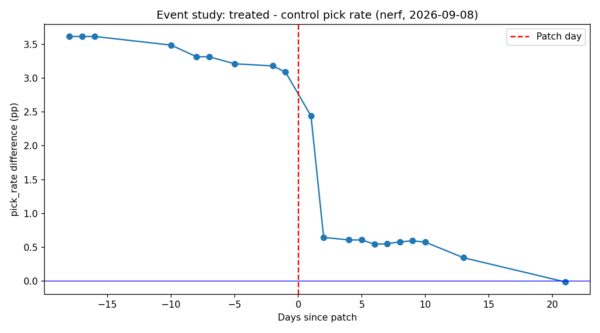

# Overwatch Patch Impact Analytics Pipeline

End-to-end ETL + causal inference pipeline that tracks how Overwatch balance
patches (buffs/nerfs/reworks) causally affect hero pick rate, win rate, and
ban rate, broken out by region and rank tier. Ban rate is included as a
leading indicator alongside the two lagging ones: players tend to ban on
reputation ("this buff made them scary") before pick/win rate fully catch
up, so a patch's effect can show up there first, or show up there even
when the win-rate effect is still too noisy to be significant.

## Why this project

Blizzard drops balance patches pretty often, and people always argue about
whether a buff or nerf actually did anything. I wanted to check that with
data: do those patches really change how heroes are picked, how often they
win, and how often they get banned, or would those numbers have moved
anyway? To answer that, I used difference-in-differences, which compares the
heroes that got patched with similar heroes that didn't, to see how much of
the change actually comes from the patch.

## Data sources & scope

Blizzard's official [Hero Statistics page](https://overwatch.blizzard.com/en-us/rates/)
publishes population-level pick rate, win rate, and ban rate per hero,
filterable by region, rank tier, and game mode. Per that page's own FAQ,
"All stats are pulled from the start of the most recent patch" — so these
numbers are already patch-scoped, not lifetime/career-cumulative stats.

The page is server-rendered: the full per-hero payload for a given
(region, tier) request is embedded directly in the initial HTML response
as JSON in a custom `<blz-data-table allrows="...">` element, so it's
scraped with plain `requests` + `BeautifulSoup` — no browser automation
needed (verified against the live page).

Every day, `extract/hero_rates_scraper.py` cycles through 3 regions ×
9 rank tiers (27 requests) to build a full daily snapshot. The causal
analysis itself (`mart_patch_event_panel`) is scoped to `region = 'Americas'`
and excludes Blizzard's own cross-tier `'All'` bucket — see the comments in
`transform/models/marts/mart_patch_event_panel.sql` for why. Asia/Europe
and the `'All'` tier are still collected and available in the dashboard.

An earlier version of this project scraped Blizzard's Top 500 leaderboard
for battletags and queried the OverFast API per player — that approach was
dropped once this page turned out to publish population-level rates
directly, which is a better source (no per-player sampling/selection bias,
no lifetime-cumulative stats diluting patch-window signal, no rate-limited
per-player HTTP calls).

## Architecture

Extract (hero rates scrape + patch notes scrape) → Load
(BigQuery) → Transform (dbt, with automated data-quality tests) → Analyze
(DiD, panel regression, event studies) → Visualize (Streamlit dashboard)

## Project structure

```
extract/
├── hero_rates_scraper.py   # Blizzard's official Hero Statistics page
└── patch_notes_scraper.py  # patch notes page → buff/nerf/rework events

load/bigquery_loader.py     # raw CSVs → BigQuery ow_raw

transform/                  # dbt project
├── models/staging/stg_hero_rates.sql, stg_patch_notes.sql
└── models/marts/mart_hero_stats_daily.sql, mart_patch_event_panel.sql

orchestration/dags/patch_impact_dag.py  # Airflow DAG (extract → load → dbt run → dbt test → analysis)

analysis/
├── did_analysis.py         # Difference-in-Differences regression
└── event_study.py          # parallel-trends event-study plots

dashboard/app.py            # Streamlit dashboard
scripts/run_daily_snapshot.sh  # what's actually scheduling the daily run (see below)
tests/                      # pytest unit tests for the scraper + DiD regression
docker-compose.yml          # Airflow + Postgres + dashboard containers
.github/workflows/ci.yml    # lint + tests, then dbt checks against BigQuery
```

**Daily automation:** a macOS launchd job fires `scripts/run_daily_snapshot.sh`
once a day, which runs `hero_rates_scraper.py`, then `patch_notes_scraper.py`,
then loads both to BigQuery. Patch notes scraping used to be run by hand
(patch notes don't change between patches, so daily scraping seemed
unnecessary) — that turned out to be a bug: a live patch dropped while the
CSV sat stale, and BigQuery's `patch_events` table kept getting
truncate-reloaded with the same outdated file every day without anyone
noticing. It's been in the daily job since 2026-09-17.

## Tech stack

Python · BigQuery · dbt · Airflow · Docker · Streamlit · 
GitHub Actions · statsmodels (DiD, panel fixed-effects)

`.github/workflows/ci.yml` runs on every push/PR to `main`: ruff lint +
`pytest tests/` for the scraper and DiD regression, then a separate
`dbt debug`/`dbt compile` job against BigQuery to catch model/schema
breakage before it reaches a daily run. Tool versions (ruff, dbt-core, dbt-bigquery) are 
pinned and the lint rules live in ruff.toml, so local and CI runs check exactly 
the same things.

## Setup

Tested on Python 3.11 (matches CI).

1. **BigQuery**: create a GCP project, a service account with BigQuery
   Data Editor + Job User roles, and the `ow_raw` / `ow_marts` datasets.
2. Copy `.env.example` to `.env` and fill in your project/dataset names.
3. `pip install -r requirements.txt`
4. `python -m extract.hero_rates_scraper && python -m extract.patch_notes_scraper`
5. `python -m load.bigquery_loader`
6. `cd transform && dbt run --profiles-dir . && dbt test --profiles-dir .`
7. `python -m analysis.did_analysis`
8. `streamlit run dashboard/app.py`

## Current status (as of 2026-11-17)

**Bugs found and fixed**:
- **Silent upstream change (2026-08, 09):** Blizzard reassigned the `rq`
  game-mode parameter, which silently corrupted 6 days of `ow_raw.hero_rates`
  with all-zero ban rates. Purged the bad rows and added a fail-loud sanity
  guard. `rq=2` was re-verified live on 2026-11-17.
- **DiD identification (2026-09):** heroes both buffed and nerfed in one patch,
  and controls leaking across overlapping patches, had reversed the estimated
  effect. Both are fixed in `scope_for_change_type()`.
- **Event and window logic (2026-09):** bug-fix-only patches now count as
  events so their heroes leave the control group; day 0 is dropped as
  ambiguous; `MIN_POST_DAYS` keeps a same-day patch out of the analysis.
- **Data hygiene (2026-09):** duplicate BigQuery rows from a manual scrape and
  a double load; a rework-classifier false positive on the bare word `"new"`.
- **CI (2026-11):** green end to end for the first time after fixing an
  uncommitted `profiles.yml`, unpinned tool versions, and a missing GCP secret.
- **Guard false positive (2026-11-17):** the guard blocked an all-zero
  snapshot that came from a new season's stats reset (53 → 54 heroes), not an
  `rq` change. See Limitations.

**Latest DiD results — patch dated 2026-09-08** (region = Americas, all
non-`All` tiers, hero + rank-tier fixed effects, hero-clustered SEs).
Patches are identified purely by calendar `patch_date` — Blizzard's page has
no season identifier anywhere in its markup.

| outcome | BUFF (n=5 heroes) | NERF (n=8 heroes, mixed-direction heroes excluded) |
|---|---|---|
| pick_rate | +0.66pp, p=0.135 | **−2.59pp, p=0.005** |
| winrate | +1.17pp, p=0.077 | −0.93pp, p=0.446 |
| ban_rate | −0.04pp, p=0.896 | +3.15pp, p=0.387 |

Nerf's pick_rate effect is the cleanest signal on record so far — right
direction, p=0.005, and the 2026-09-08 event study (below) shows a mostly flat
pre-trend (a slight ~0.5pp drift over three weeks) followed by a sharp drop
within two days of the patch. Buff points the right way but isn't significant
at n=5. Not enough data yet for the 2026-09-17 D.Mon nerf (`MIN_POST_DAYS`) or
for reworks (none on record after the classifier fix).



**Interpretation:** Nerfs moved pick rate significantly but not win rate.
My hypothesis is that players react to the *signal* of a nerf (they stop
picking the hero) faster than the hero's actual strength shows up in
results — the event study shows most of the pick-rate drop happening within
two days of the patch. But this is not confirmed yet, since the win-rate estimate may
simply be underpowered at n=8, and selection could also mask it — if
casual players drop the hero first, the remaining players skew toward
specialists, which props up its win rate. The ban-rate-as-leading-indicator
hypothesis from the design was not supported for this patch.

## Limitations & mitigations

- **Sample size isn't disclosed.** Blizzard doesn't publish game counts
  behind each rate; rare heroes/mirror matchups show as `"--"`, converted to
  `null` rather than guessed. No confidence interval on Blizzard's own numbers.
- **Win rate is cumulative-since-patch-start, not daily.** `days_since_patch`
  = 1 reflects ~1 day of games, = 20 reflects ~20 — early observations are
  noisier. Not corrected for in the code.
- **No historical backfill.** The page reflects only the current patch, so
  causal analysis only covers patches observed since this pipeline went live.
- **Parallel-trends isn't guaranteed.** `event_study.py` checks it visually,
  but same-patch confounders (map changes, other heroes shifting the meta)
  aren't controlled for in the regression.
- **Region scope.** DiD is fixed to Americas to avoid mixing regional metas;
  Asia/Europe are collected but not analyzed causally.
- **Cluster-robust SEs are near-degenerate at this roster size.** ~40-50
  hero fixed effects against ~40-50 hero clusters is right at the edge of
  what cluster-robust variance estimation needs — a small-N constraint of
  the roster, not something code cleanup fixes.
- **Heroes buffed and nerfed in the same patch are excluded from both
  arms.** Their net effect is ambiguous, so `find_mixed_heroes` drops them
  rather than guessing a direction.
- **Collection gaps.** The daily job runs on a laptop via launchd, so days the machine was off are missing (e.g. 2026-10-30 to 11-09). That left the
  2026-11-03 patch without enough early post-patch data to analyze.
- The ban-rate guard can't tell a parameter change from a stats reset. Both look like all-zero ban rates. A next step is to retry the other rq values
  automatically, and to compare against the latest patch date before refusing a snapshot.